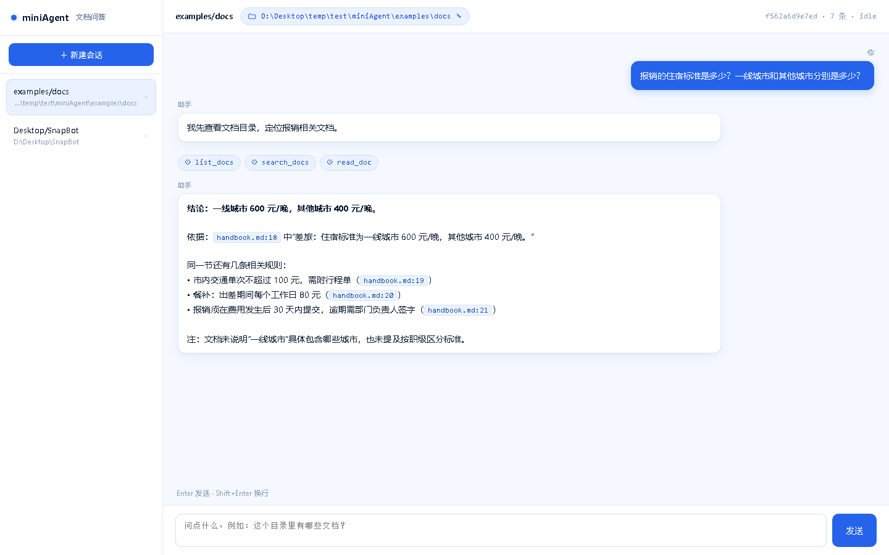
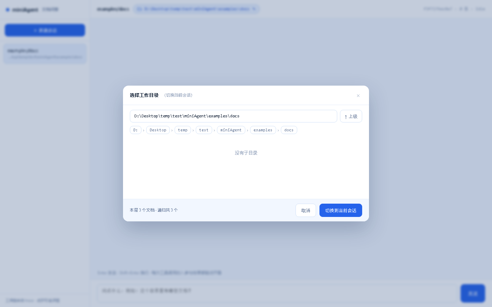

# miniAgent · 文档问答

从零实现的最小可用 Agent Runtime。**不依赖任何 agent 框架**（没有 LangChain / LangGraph /
OpenHands / 任何 orchestration 库），**零第三方依赖**（只 Python 标准库），同一份 Runtime
提供 **CLI** 与 **Web** 两个入口。

给定一个文件夹（或单个文件）作为根目录，用户用自然语言提问，Agent 自行决定：

```
看有哪些文档 → 看结构目录 → 跨文件检索 → 按行精读 → 记账/算数 → 回答并给出行号依据
```

---

## 1. 快速开始

```bash
# 1) 配好模型（OpenAI-compatible 都能用：DeepSeek / GLM / Qwen / 本地 Ollama）
cp .env.example .env
#   编辑 .env：MINIAGENT_API_KEY=sk-xxx

# 2) CLI 交互
python main.py cli --root examples/docs

# 3) Web 界面
python main.py web --root examples/docs --port 8000
#   浏览器打开 http://127.0.0.1:8000（白蓝界面，顶部文件夹胶囊可切换工作目录）

# 没有 key 也能跑通完整链路（用 DemoLLM 演示循环，不消耗 API）
python main.py cli --root examples/docs --fake
```

环境要求：Python 3.11+，无 pip 安装步骤。

`.env` 配置项：

| 变量 | 默认 | 说明 |
| --- | --- | --- |
| `MINIAGENT_API_KEY` | 空 | 必填（也可用 `DEEPSEEK_API_KEY`） |
| `MINIAGENT_BASE_URL` | `https://api.deepseek.com/v1` | 换供应商只改这里 |
| `MINIAGENT_MODEL` | `deepseek-chat` | 模型名 |
| `MINIAGENT_CONTEXT_WINDOW` | `32768` | 模型窗口（用于算预算） |
| `MINIAGENT_MAX_ROUNDS` | `8` | 每轮交互最多几次模型往返（含最终作答） |

---

## 2. 系统设计

```
                        ┌─────────────────────────────┐
  CLI (cli.py) ────────► │                             │
                        │            App              │  ← 门面：会话/装配/调用
  Web (web/server.py)──► │  (app.py)                   │
                        └──────────┬──────────────────┘
                                   │
        ┌──────────────────────────┼───────────────────────────┐
        ▼                          ▼                           ▼
  runtime/loop.py           context/manager.py            tools/
  Agent 主循环              上下文装配与压缩              工具注册与执行
  四个出口                   记忆召回                      7 个内置工具
        │                          │                           │
        ├──────────► llm.py ◄──────┘                           │
        │            HTTP（urllib，直连 /chat/completions）      │
        ▼                                                      ▼
  store/session.py（sqlite：sessions/messages/todos/memories）  trace.py（JSONL）
```

### 2.1 目录结构与代码量

`wc -l` 实测（不含测试）：

| 文件 | 行数 | 职责 |
| --- | --- | --- |
| `miniagent/llm.py` | 125 | OpenAI-compatible HTTP 客户端，重试/退避，响应规范化 |
| `miniagent/tools/base.py` | 160 | Tool 描述、注册中心、JSON-Schema 子集校验、错误回填 |
| `miniagent/tools/builtin.py` | 297 | 7 个工具的实现与 schema（description 即 prompt，占了大半篇幅） |
| `miniagent/tools/docs.py` | 239 | 路径沙箱、多格式读行（docx 用 zipfile 解）、结构提取、检索打分 |
| `miniagent/context/manager.py` | 212 | 预算估算、轮组切分、滚动摘要、记忆召回 |
| `miniagent/runtime/loop.py` | 145 | Agent 主循环与四个出口 |
| `miniagent/store/session.py` | 176 | sqlite 持久化（会话/消息/待办/记忆） |
| `miniagent/trace.py` | 49 | 调用链 JSONL 落盘 |
| `miniagent/app.py` | 101 | 门面，CLI/Web 共用 |
| `miniagent/cli.py` | 141 | 交互式命令行 |
| `miniagent/web/server.py` | 136 | 标准库 http.server，5 个 JSON 接口 |
| `miniagent/dispatch.py` + `main.py` | 54 | 参数解析（`cli` / `web` 两个子命令） |
| `miniagent/config.py` | 72 | 配置与 `.env` |
| 其他（`__init__` / `fake_llm` / `demo_llm`） | 136 | 包声明、测试用 FakeLLM、无 key 演示用的 DemoLLM |

**代码量拆分（便于判断哪块值得读）**

- Runtime 内核（LLM 客户端 + 主循环 + 上下文 + 存储 + 工具注册）≈ **970 行**
- 工具实现（7 个工具 + 文档解析）≈ **536 行**，其中相当篇幅是给模型看的 schema 描述文案
- 两个前端（CLI + Web）≈ **320 行**
- 测试 ≈ **750 行**，57 个用例

### 2.2 主循环（`runtime/loop.py`）

```python
for round_no in range(1, max_rounds + 1):
    built = ctx.build(session_id, root)                 # ① 每轮重新装配上下文
    reply = llm.chat(built.messages, tools=specs)       # ② 调模型（带工具 schema）
    if not reply.tool_calls:                            # 出口①：直接回答
        return reply.content
    for call in reply.tool_calls:                       # ③ 执行工具
        result = registry.invoke(call.name, call.arguments)
        store.append_message("tool", result, tool_call_id=call.id)
# 出口②：轮次用尽
```

四个出口全部可枚举：**直接回答 / 轮次用尽 / 同参重复被拦截 / 模型调用失败**。
没有递归、没有回调、没有隐藏状态机——这是刻意选的：同步循环最容易推理和测试。

### 2.3 工具集设计：渐进式披露

文档问答最大的风险是“把整个目录灌进 context”。所以工具是**分层递进**的：

| 工具 | 什么时候被调用 | 输出 |
| --- | --- | --- |
| `list_docs` | 不知道有哪些文件 | 相对路径 + 大小 |
| `outline` | 想知道一个文件讲什么 | 标题树 / def-class / 段落首行，带行号 |
| `search_docs` | 想定位“哪个文件提到 X” | `路径:行号` + 片段，按分数排序 |
| `read_doc` | 已经定位到行号 | 指定行区间的原文（带行号） |
| `todo` | 多步阅读计划 | add / list / done |
| `calculator` | 计数、求和、比例 | AST 白名单求值，**禁用 `eval`** |
| `remember` | 用户要求记住稳定事实 | 写入长期记忆，下轮自动召回 |

三个约束写死在工具层：

1. **路径沙箱**：所有路径都过 `resolve()`，越出根目录直接 `ERROR: 路径越界`；
2. **错误回填**：参数校验失败 / 工具异常一律转成 `ERROR: ...` 的 tool 消息回给模型，
   而不是抛到循环外——模型看到错误才有机会自纠；
3. **结果截断**：单次工具结果超 6000 字符截断，避免一次 `read_doc` 撑爆预算。

### 2.4 思考路径（reasoning）的提取与边界

题目要求“提取思考过程、工具调用或最终答案”，三者现在的落点：

| 模型输出字段 | 落点 | 是否回填进下一次请求 |
| --- | --- | --- |
| `reasoning_content` / `reasoning` | `LLMReply.reasoning` → trace 的 `llm` 事件 → CLI `💭` 行 / Web 紫色 chip | **绝不回填** |
| `tool_calls` | `assistant.tool_calls` + `tool_call_id` 配对入库 | 回填（协议必需） |
| `content` | `assistant.content` | 回填 |

为什么思考路径不能回填：DeepSeek 的 reasoner 模型明确要求 `reasoning_content`
**不得出现在输入 messages 里**，否则直接 400。所以它只走“观测通道”（trace / UI），
不走“对话通道”。`tests/test_loop.py::test_reasoning_is_captured_but_never_echoed_back`
同时断言了这三件事：事件里能拿到、库里没有、下一次请求体里也没有。

想看真实思考路径，把 `.env` 里的模型换成 `deepseek-reasoner` 即可（支持工具调用）：

```bash
MINIAGENT_MODEL=deepseek-reasoner python main.py cli --root examples/docs --once "报销住宿标准是多少？"
#   💭 思考 30 字：Let me look at the docs first.…
#   ⚙ list_docs({}) → 共 3 个文档…
```

### 2.5 context 与 memory

**装配顺序（固定）**

```
[system]   角色 + 工具使用规则
[system]   会话根目录
[system]   召回到的长期记忆          ← 不参与压缩
[system]   更早对话的滚动摘要        ← 压缩产物
[..]       最近 N 条消息原文（按轮组保留）
```

**召回时机**：每轮 **调用模型之前**，在 `ContextManager.build()` 里一次性完成；
查询词取“最近一条用户消息”。不在轮次结束后回写，也不在收到消息时单独算。

**放置方式**：召回到的事实以独立的 `system` 消息插在角色说明之后、历史之前。
不塞进历史里，原因是历史会被压缩，而记忆不该被压掉。

**压缩策略**（超预算时，从最老轮组往外丢）：

1. 先丢整组（`assistant(tool_calls)` + 对应的 `tool` 结果必须同组删，否则请求 400）；
2. 丢掉的原文交给 summarizer 压成一条摘要，只保留：用户目标与约束、已确认结论（带
   `文件:行号`）、未完成动作；
3. 摘要写回 `sessions.summary`，下轮装配时以一条 `system` 出现。

`LLMSummarizer` 用模型做摘要；模型失败时降级成 `mechanical_summary`（纯截断），
**对话不能因为摘要失败而挂掉**。

### 2.6 会话与并发

`sqlite` 四张表：`sessions` / `messages` / `todos` / `memories`。
会话有状态机 `idle | busy`：`busy` 期间新请求直接返回“上一条还在处理中”，
避免 Web 端双击重复提交把同一个会话写乱。

---

### 2.7 Web 界面

白蓝配色，左侧会话列表、右侧对话区，**顶部那个文件夹胶囊就是工作目录切换入口**：

- 点它打开目录选择器：面包屑逐级下钻、`↑ 上级`、也可直接粘贴绝对路径回车跳转；
  底部显示「本层 N 个文档 · 递归共 M 个」，避免选错目录；
- 两个动作：**切换到当前会话**（历史消息保留，之后的问题就查新目录）和**新建会话并用它**；
- 另有深链 `http://127.0.0.1:8000/?picker=1`，打开即弹出选择器（演示/截图方便）。
- 工具 chip 点开是调用详情面板，三种关法：右上角 `×`、`Esc`、再点同一 chip 收起；
- 会话条目右侧有 `×`（悬停出现），二次确认后删除，**消息/待办/记忆一起级联删除**；
  删的若是当前会话，自动切到剩下的第一个；`state=busy` 时会拒绝删除（409）。

接口 8 个（另有 1 个页面路由），全部返回 JSON：

| 方法 | 路径 | 作用 |
| --- | --- | --- |
| GET | `/` | 单页 UI（`web/index.html`，零构建步骤） |
| GET | `/api/sessions` | 会话列表（含根目录、消息数、状态） |
| GET | `/api/sessions/<id>/messages` | 消息历史（含 `role=tool`） |
| GET | `/api/sessions/<id>/trace` | 最近事件（调用链） |
| GET | `/api/roots` | 最近用过的根目录 |
| GET | `/api/browse?path=` | 目录选择器：子目录 + 文档计数 |
| POST | `/api/sessions` | 新建会话（可带 `root`） |
| POST | `/api/sessions/<id>/root` | **切换工作目录** |
| POST | `/api/chat` | 发一条消息，返回 `reply/events/rounds/stopped` |
| DELETE | `/api/sessions/<id>` | **删除会话**（级联消息/待办/记忆；busy 时 409） |

界面自检过的四个状态（Chrome headless 截图核对）：空会话态、真实问答态（用户气泡 / 工具 chip 行 /
Markdown 渲染）、目录选择器、白蓝配色无深色残留。




---

## 3. 测试

```bash
python -m unittest discover -s tests -t tests -v
# Ran 57 tests ... OK
```

不需要网络和 API key：`FakeLLM` 按脚本返回，工具在临时目录里跑。

| 测试文件 | 覆盖 |
| --- | --- |
| `tests/test_tools.py` (12) | 路径越界拦截、docx 解析、计算器注入防护、todo 生命周期、schema 报错文案 |
| `tests/test_loop.py` (9) | 四个出口、工具协议配对（`tool_call_id`）、一轮多工具、错误回填后自纠、**思考路径不回传** |
| `tests/test_context.py` (7) | 轮组切分、超预算压缩并落摘要、最近一轮保留、记忆召回命中、工具 schema 计入预算 |
| `tests/test_app.py` (18) | 会话隔离、trace 落盘、配置错误文案、Web 接口（目录浏览 / 切换根目录 / 删除会话 404·409） |
| `tests/test_llm.py` (8) | 思考路径/工具调用/最终答案的解析、块数组 content、畸形响应 |

---

## 4. AI Prompt 与问题解决记录

**给模型的 system prompt 只有 5 条**（`context/manager.py` 的 `SYSTEM_PROMPT`），
每一条都是为了压住一种失败模式：

| 规则 | 压制的失败模式 |
| --- | --- |
| 先定位再精读，不要凭空猜 | 模型直接编答案 |
| 工具按需组合，别一次读完 | 一上来 `read_doc(1, 9999)` 把预算吃光 |
| 回答给 `文件:行号` | 无法验证的结论 |
| 工具返回 ERROR 时先读懂 | 同一参数反复撞墙 |
| 中文、先结论后证据 | 长篇铺垫 |

**踩过的坑（按时间）**

1. **`attribs` 段长是 base36**（飞书文档转换时踩到，与本项目无关但同源教训：
   先跑现成工具再决定写不写新代码）。
2. **压缩时按条删消息导致 400**：`assistant(tool_calls)` 与 `tool` 消息是协议配对的，
   必须按“轮组”删——这就是 `group_turns()` 存在的原因。
3. **模型把整数写成字符串**（`"start": "1"`）：schema 校验里做了宽容转换，
   转不了才报错，否则模型会被无意义的类型错误卡住。
4. **`read_doc` 单次读太多**：加了 400 行上限 + 截断提示，把“读多少”交还给模型决定。
5. **摘要失败不能中断对话**：`LLMSummarizer` 里兜底降级到机械摘要。

